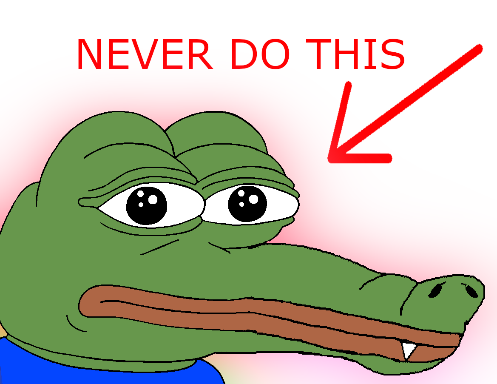

# Laws of interfaces

From suited_rewrite's design_philosophy.md and ruhe_principles.md
(2026-10-06…08); adopted by suited 2026-10-27; a module 2026-11-01. The
examples are suited's poker tables.

## What UI/UX is for
UI/UX gives the player ACCURATE information about the current game state and
the actions available to them.
- **Show the best approximation of the state there is**: deterministic
  predictions (you act in 3 turns; the tournament starts at 00:00 London
  time; your turn ends 15 s after it starts) and partial true information
  (your raise was sent; it is being checked; it was $666 against a $2 stack,
  so it will fail — but the server says so first).
- **Never** show what the state might have been had something been
  different (a greyed create-a-room button "if you had connected"; a
  half-transparent slider "if it were your turn"), never hide true and
  relevant state for looks, and never leave the player to remember, infer
  or work out a figure the screen could show.
- **State facts, don't sell.** No marketing prose inside the product.

## Emphasis goes one way
We EMPHASISE what matters; we never de-emphasise the rest with fades,
transparency or darkening. Something temporarily unavailable (an action out
of turn) stays visible in place; something permanently unavailable (a raise
when no raise is legal) is not drawn at all.

## Discoverability
Everything a player may want is reached by an obvious sequence of labelled
steps. Nothing essential appears only on hover, a swipe, a mysterious "more…"
or ">". **No glowing arrows at Pepe:** a signifier that points without saying
(a glow, an arrow, a pulse) is allowed only when missing it is safe or one
use teaches it forever; everything else that glows must also SAY.

## Controls are furniture
A control is recognisable by its position, shape and colour, and never
changes its place. Hiding one is allowed only when it comes back in exactly
the same spot. The action bar holds one shape whenever the player is at the
table in any capacity (acting, waiting, all in, sitting out). Dynamic layout
is for content.

## Room for the worst case (ruled 2026-11-02)
Size every box for the most it can ever hold before anything is drawn: the
longest note, the widest number, the second line a late answer may bring.
A part that arrives late (a fetch, a floor, a count) lands in room already
kept for it. Nothing grows, shrinks or moves after it first appears: no
button that shows and then narrows, no row pushed down by a note that came
a moment later. Keep the room empty, or wait and draw the whole state at
once; never draw and then reflow.

## Dangerous actions are deliberate (ruled 2026-10-27)
An action that can cost a stack in one press has no shortcut: no hotkey, no
gesture, and no ONE-PRESS BUTTON for going all in. All in is the top of the
raise range, reached by typing the amount (`r 9.31`) or by moving the
slider to its end — so a stack is never lost to a misclick, a stray key or a
thumb on the wrong row. Fold and leave stay click-only (the rewrite's rule,
2026-10-08). Input is sequences, never chords: one key, no modifiers, no
holding; every hotkey is shown in its control and rebindable.

## The client is not a second rules engine
The server's snapshot is the single truth for legality: the client FORMATS
it, GATES on it and sends intents back. It never re-derives legality, limits
or amounts from stacks, bets or history (a short all-in below the minimum
raise does not reopen betting: `stack → canRaise` is wrong exactly there).
A number the client needs and the snapshot lacks gets ADDED to the snapshot.

## Draw the whole screen before building it (ruled 2026-10-22)

A screen is judged whole, before a line of it is built. What happened: the
rail grew a part per request — table headers, a mini action bar, a pin
row, deposit steps — each sensible alone, never judged together, and each
went straight to the site the client watches. Half-built screens shown to
the client have hurt the relationship more than once.

So, before UI code: the whole screen as text, at its real width (the
rail is 320px, about 40 characters), with real data, in every state it
has (seated, joining, busted, watching, empty, between hands). Text suits
us: everything here is a grid of rows. The question asked of the sketch
is "is this exactly what we want?", and building starts on a yes. A part
that would be a stopgap is named as one and kept off the client's view.

**The sketch is a text layout (ruled 2026-10-24).** Claude is made of text,
and the owner draws layouts in it, so text is where we meet. Two forms,
both in a fenced block so the spacing holds:

- **A screen** in box-drawing characters, at its proportions: the nav, the
  felt's rows, the rail, each region with real labels and real figures.

      ┌ nav ──────────────────────────────────────────┬──────────────────┐
      │ ◆ SUITED  TRAINING NLH │ lobby  docs   0xab…  │ 02:14 · #7f3a…   │
      ├───────────────────────────────────────────────┤ [Q♠][J♠][4♦]     │
      │                [ north plate ]                │ pot 6.40         │
      │   [ nw plate ]                 [ ne plate ]   ├──────────────────┤
      │            [  board  ·  pot  ]                │ … older hands …  │
      │                   [  you  ]                   │                  │
      ├───────────────────────────────────────────────┤                  │
      │  fold   check   bet 0.40   [====|====]  0.40  │ > /              │
      └───────────────────────────────────────────────┴──────────────────┘

- **A part, state by state**: one line per state, its name on the left,
  the controls in [ brackets ] as they read.

      no limit           [ fold ]  [ call 0.40 ]  [ raise to 1.20 ]  [====|====]  [min] [½] [all in]
      fixed limit        [ fold ]  [ call 0.40 ]  [ raise to 0.60 ]  small bet 0.20 · bet 3 of 4
      capped             [ fold ]  [ call 0.40 ]                      4 of 4: calls only

A grid change is drawn as the grid it makes (`- 0 - 1 -` / `- - H - -`),
the way the owner drew the three-to-five-chair tables. Words describe; the
drawing decides.

## Brevity and density (ruled 2026-10-22)

Our advantage over the client's version is brevity and density: more
information in less room. The opposite of marketing text. A row says a
figure, a name, a state; never a sentence explaining itself. "short 2.16"
over "for the maximum $2.16 more"; "min 31.20 till 14:05" over "you left
this table with $31.20 within the hour: until 14:05 you come back with at
least $31.20". A rule that needs a sentence goes in the docs, not on the
screen. State already shown elsewhere on screen is not shown twice.
